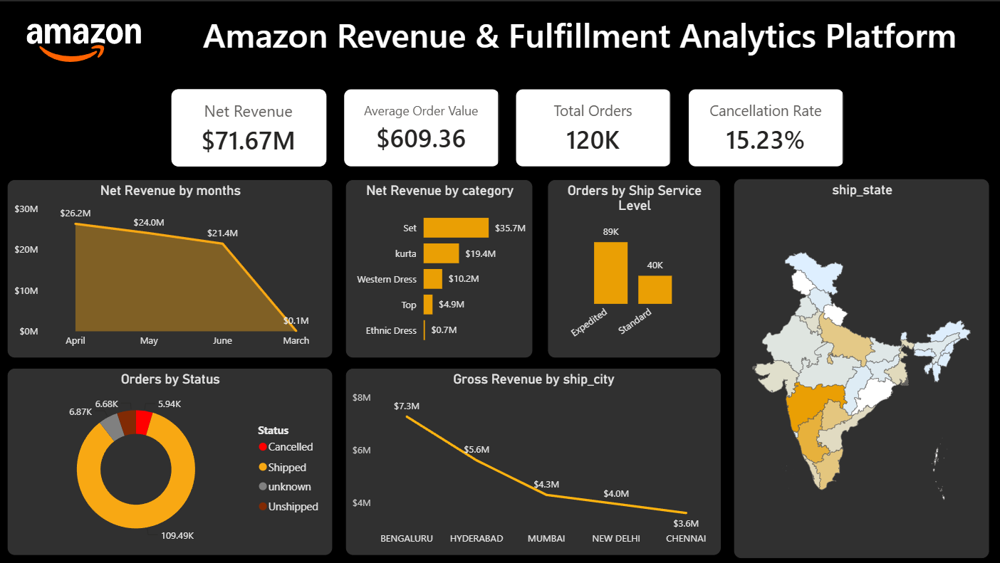

# Amazon Revenue & Fulfillment Analytics Platform

## 📌 Executive Summary
This project transforms 128,000+ raw, unorganized Amazon sales records into a high-performance relational analytics system and an executive-ready Power BI reporting engine. By standardizing spatial-temporal schema anomalies and tracking multi-channel fulfillment pathways, the analysis identified **₹71.67M in net realized revenue** while exposing a **15.23% order cancellation rate** that accounts for **₹6.92M in uncaptured revenue potential**.

## 🎯 Business Problem
* **Background:** Rapid e-commerce growth often leads to operational leaks, stockout cancellations, and unoptimized inventory allocation across multi-channel fulfillment models (Amazon FBA vs. Merchant Direct).
* **Objective:** Clean messy transaction logs, model net revenue performance excluding unfulfilled orders, and isolate revenue drivers and delivery bottlenecks to optimize inventory allocation and logistics efficiency.
* **Target Audience:** Supply Chain Managers, E-Commerce Operations Lead, Inventory Strategists, and C-Suite Executives.

## 📊 Dataset & Tools
* **Dataset:** Amazon Sale Report (128,975 rows, 24 original columns)
* **Tools Used:** 
  * **Data Cleaning & Analysis:** VS Code (Python) and MySQL Workbench (Data Cleaning, Schema Optimization, Views)
  * **Visualization & BI:** Power BI (4-Zone Modular Dashboard, DAX, Interactive Filters)
  * **Documentation & Reporting:** GitHub Markdown, Python (ReportLab PDF Generation)

## 💡 Key Insights & Findings
1. **Product Portfolio Revenue Concentration:** Over **79.6% of net sales revenue** (₹57.03M) is driven by just two categories: **Set (49.9% / ₹35.73M)** and **Kurta (29.7% / ₹21.30M)**, while categories like *Saree* and *Dupatta* account for less than **0.3%** combined.
2. **Operational Leakage & Order Cancellations:** The overall order cancellation rate stands at **15.23%** across 120,378 distinct orders, causing a total gross revenue loss of **₹6,919,284.30** primarily due to stockouts and pre-courier handoff delays.
3. **Fulfillment Channel Dominance:** Amazon FBA (Fulfilled by Amazon) generates **70.6% of total net revenue** and demonstrates higher order completion rates and ticket sizes compared to Merchant-fulfilled (*Easy Ship*) orders.

## 🚀 Actionable Business Recommendations
1. **Automate Inventory Syncs (Short-term Action):** Implement real-time automated API stock-level synchronizations between warehouse inventory management systems (WMS) and Amazon Seller Central to eliminate out-of-stock cancellations and recover up to **₹6.9M in leaked revenue**.
2. **Reallocate Capital & Shift Fulfillment Strategy (Long-term Strategy):** Transition high-margin *Set* and *Kurta* SKUs fully to Amazon FBA to leverage faster shipping SLAs, while reducing safety stock capital bound to low-performing categories (*Sarees* and *Dupattas*).

## 🖼️ Dashboard Preview


## 🛠️ Repository Structure
```text
├── dashboard/
│   └── amazon_sales_report.png             # dashboard view
|   └── amazon_sales.pbix                   # Power BI report file with DAX measures & 4-zone layout
├── data/
│   ├── Amazon Sales Report.csv             # Raw dataset
│   └── amazon_cleaned_report.csv           # cleaned dataset
├── scripts/
│   └── preprocess.ipynb
|   └── EDA.sql                             # Data cleaning, null handling, date conversions
|   └── clean_preprocess.sql                # Production reporting view for Power BI integration
├── docs/
│   └── Executive_Summary_Amazon_Sales.pdf  # Generated 1-page executive summary PDF
└── README.md                               # Project documentation